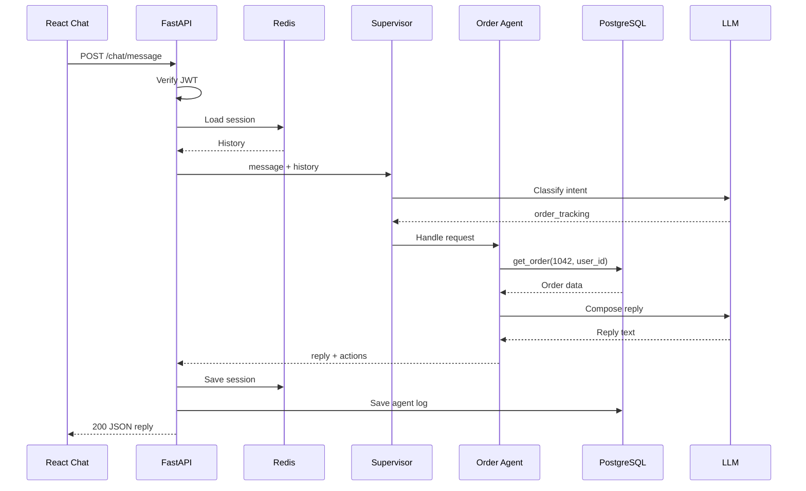
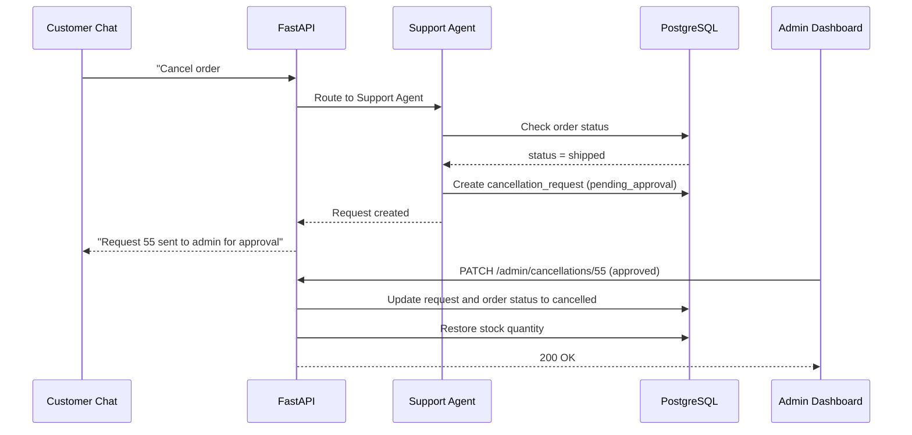

# API Design

> Status: Draft v1
> Project: AI E-Commerce Operations Agent

## 1. Overview

This document defines the REST API contract between the React frontend and the FastAPI backend.

- **Base URL:** `/api/v1` (example: `https://<backend-url>/api/v1`)
- **Format:** All requests and responses use JSON
- **Naming:** Plural, lowercase resource names (`/products`, `/orders`)
- **Dates:** ISO 8601 (`2026-11-22T20:47:00Z`)
- **Interactive docs:** FastAPI Swagger UI at `/docs`
- **Testing:** Postman collection stored in `docs/postman/`

## 2. Authentication

- Users log in and receive a JWT access token.
- Every protected request sends the header `Authorization: Bearer <token>`.
- The token carries `user_id` and `role` (`customer` or `admin`).
- All `/admin/*` endpoints require the `admin` role.
- Customers can access only their own orders, complaints and chat sessions.

Example:

```json
POST /api/v1/auth/login
{
  "email": "user@example.com",
  "password": "secret123"
}
```

```json
200 OK
{
  "access_token": "eyJhbGciOi...",
  "token_type": "bearer",
  "user": { "id": 7, "name": "Amit", "role": "customer" }
}
```

## 3. Endpoints

### 3.1 Auth

| Method | Path             | Auth   | Purpose                  |
| ------ | ---------------- | ------ | ------------------------ |
| POST   | `/auth/register` | Public | Create a new account     |
| POST   | `/auth/login`    | Public | Log in and get a token   |
| GET    | `/auth/me`       | User   | Get current user profile |

### 3.2 Chat

| Method | Path                          | Auth     | Purpose                               |
| ------ | ----------------------------- | -------- | ------------------------------------- |
| POST   | `/chat/message`               | Customer | Send a message to the agents          |
| GET    | `/chat/sessions/{id}/history` | Customer | Get conversation history of a session |

### 3.3 Products

| Method | Path                  | Auth   | Purpose                                     |
| ------ | --------------------- | ------ | ------------------------------------------- |
| GET    | `/products`           | Public | List products (pagination, category filter) |
| GET    | `/products/search?q=` | Public | Search products by keyword, category, price |
| GET    | `/products/{id}`      | Public | Get one product                             |
| POST   | `/products`           | Admin  | Create a product                            |
| PUT    | `/products/{id}`      | Admin  | Update a product                            |
| DELETE | `/products/{id}`      | Admin  | Delete a product                            |

### 3.4 Inventory

| Method | Path                      | Auth  | Purpose                  |
| ------ | ------------------------- | ----- | ------------------------ |
| GET    | `/inventory/{product_id}` | User  | Check stock of a product |
| PATCH  | `/inventory/{product_id}` | Admin | Update stock quantity    |

### 3.5 Orders

| Method | Path            | Auth                      | Purpose                                            |
| ------ | --------------- | ------------------------- | -------------------------------------------------- |
| GET    | `/orders/my`    | Customer                  | List my orders                                     |
| GET    | `/orders/{id}`  | Customer (own order only) | Get one order with shipment details                |
| GET    | `/admin/orders` | Admin                     | List all orders (filter by status, date, customer) |

### 3.6 Cancellations

| Method | Path                        | Auth     | Purpose                        |
| ------ | --------------------------- | -------- | ------------------------------ |
| POST   | `/orders/{id}/cancel`       | Customer | Request order cancellation     |
| GET    | `/admin/cancellations`      | Admin    | List all cancellation requests |
| PATCH  | `/admin/cancellations/{id}` | Admin    | Approve or reject a request    |

### 3.7 Complaints

| Method | Path                     | Auth     | Purpose                                    |
| ------ | ------------------------ | -------- | ------------------------------------------ |
| POST   | `/complaints`            | Customer | Raise a complaint                          |
| GET    | `/admin/complaints`      | Admin    | List all complaints                        |
| PATCH  | `/admin/complaints/{id}` | Admin    | Update status, priority, assignee or reply |

### 3.8 Monitoring

| Method | Path                | Auth  | Purpose                                        |
| ------ | ------------------- | ----- | ---------------------------------------------- |
| GET    | `/admin/stats`      | Admin | Orders today, open complaints, low-stock count |
| GET    | `/admin/agent-logs` | Admin | Agent action logs (filter by agent, date)      |

## 4. Request and Response Examples

### 4.1 Send chat message

```json
POST /api/v1/chat/message
Authorization: Bearer <token>

{
  "session_id": "a3f9c1e2",
  "message": "Track my order #1042"
}
```

```json
200 OK
{
  "session_id": "a3f9c1e2",
  "reply": "Your order #1042 has been shipped and should arrive by 25 Nov.",
  "agent_used": "order_tracking",
  "actions_taken": [
    {
      "tool": "get_order",
      "args": { "order_id": 1042 },
      "status": "success"
    }
  ],
  "created_at": "2026-11-22T20:50:00Z"
}
```

If `session_id` is empty on the first message, the server creates one and returns it.

### 4.2 Search products

```json
GET /api/v1/products/search?q=headphones&max_price=5000

200 OK
{
  "items": [
    {
      "id": 12,
      "name": "BoomBeat Wireless Headphones",
      "price": 3499.00,
      "category": "Audio",
      "in_stock": true
    }
  ],
  "total": 1,
  "page": 1
}
```

### 4.3 Check stock

```json
GET /api/v1/inventory/12

200 OK
{
  "product_id": 12,
  "quantity": 25,
  "in_stock": true,
  "low_stock": false
}
```

### 4.4 Update inventory (admin)

```json
PATCH /api/v1/inventory/12
Authorization: Bearer <admin-token>

{
  "quantity": 40,
  "reorder_level": 10
}
```

```json
200 OK
{
  "product_id": 12,
  "quantity": 40,
  "reorder_level": 10,
  "low_stock": false
}
```

### 4.5 Get order

```json
GET /api/v1/orders/1042

200 OK
{
  "id": 1042,
  "status": "shipped",
  "total_amount": 3499.00,
  "items": [
    { "product_id": 12, "name": "BoomBeat Wireless Headphones", "quantity": 1, "unit_price": 3499.00 }
  ],
  "shipment": {
    "carrier": "MockExpress",
    "tracking_number": "MX123456",
    "status": "in_transit",
    "eta": "2026-11-25"
  },
  "created_at": "2026-11-20T10:15:00Z"
}
```

### 4.6 Request cancellation

```json
POST /api/v1/orders/1042/cancel

{
  "reason": "Ordered by mistake"
}
```

```json
201 Created
{
  "request_id": 55,
  "order_id": 1042,
  "status": "pending_approval"
}
```

### 4.7 Approve or reject cancellation (admin)

```json
PATCH /api/v1/admin/cancellations/55

{
  "status": "approved",
  "admin_note": "Approved before dispatch."
}
```

```json
200 OK
{
  "request_id": 55,
  "order_id": 1042,
  "status": "approved",
  "order_status": "cancelled"
}
```

### 4.8 Raise complaint

```json
POST /api/v1/complaints

{
  "order_id": 1042,
  "subject": "Damaged item",
  "description": "Screen cracked on arrival"
}
```

```json
201 Created
{
  "ticket_id": 301,
  "status": "open",
  "priority": "medium"
}
```

### 4.9 Update complaint (admin)

```json
PATCH /api/v1/admin/complaints/301

{
  "status": "resolved",
  "priority": "high",
  "reply": "Replacement shipped."
}
```

```json
200 OK
{
  "ticket_id": 301,
  "status": "resolved",
  "updated_at": "2026-11-22T21:00:00Z"
}
```

### 4.10 Admin stats

```json
GET /api/v1/admin/stats

200 OK
{
  "orders_today": 18,
  "open_complaints": 4,
  "pending_cancellations": 2,
  "low_stock_products": 5
}
```

## 5. Standard Error Format

All errors use the same shape so the frontend can handle them in one place.

```json
{
  "error": {
    "code": "ORDER_NOT_FOUND",
    "message": "Order not found",
    "details": null
  }
}
```

Common error codes:

| Code                 | Meaning                                  |
| -------------------- | ---------------------------------------- |
| `VALIDATION_ERROR`   | Input failed validation                  |
| `UNAUTHORIZED`       | Missing or invalid token                 |
| `FORBIDDEN`          | Role not allowed                         |
| `ORDER_NOT_FOUND`    | Order missing or not owned by the user   |
| `PRODUCT_NOT_FOUND`  | Product does not exist                   |
| `CANCEL_NOT_ALLOWED` | Order status does not allow cancellation |
| `LLM_UNAVAILABLE`    | LLM provider failed or timed out         |
| `RATE_LIMITED`       | Too many requests                        |

## 6. HTTP Status Codes

| Code | Meaning               | When used                                                     |
| ---- | --------------------- | ------------------------------------------------------------- |
| 200  | OK                    | Successful read or update                                     |
| 201  | Created               | New resource created                                          |
| 400  | Bad Request           | Invalid operation (for example, cancelling a delivered order) |
| 401  | Unauthorized          | Token missing or invalid                                      |
| 403  | Forbidden             | User role lacks permission                                    |
| 404  | Not Found             | Resource missing (also used for another user's order)         |
| 422  | Unprocessable Entity  | Request body failed validation                                |
| 429  | Too Many Requests     | Rate limit exceeded                                           |
| 500  | Internal Server Error | Unexpected server error                                       |
| 503  | Service Unavailable   | LLM provider unavailable                                      |

Note: another customer's order returns 404, not 403, so the existence of the order is not revealed.

## 7. Communication Flow

Example: customer sends "Track my order #1042".

1. React sends `POST /chat/message` with `session_id` and `message`.
2. FastAPI verifies the JWT and extracts `user_id`.
3. FastAPI loads the session history from Redis.
4. The Supervisor Agent classifies the intent as `order_tracking`.
5. The Order Tracking Agent calls the tool `get_order(order_id, user_id)`.
6. The service layer queries PostgreSQL using both `order_id` and `user_id`.
7. The tool result is passed to the LLM, which writes the reply.
8. The updated conversation is saved to Redis and the agent log is saved to PostgreSQL.
9. FastAPI returns the JSON reply to React.

## 8. Sequence Diagram

Flow: "Track my order #1042"



## 9. Sequence Diagram: Cancellation with Admin Approval

Flow: customer cancels a shipped order (human-in-the-loop).



## 10. Traceability

| Use Case                    | Endpoint(s)                                 |
| --------------------------- | ------------------------------------------- |
| CU-01 Ask product question  | `POST /chat/message`                        |
| CU-02 Search products       | `GET /products/search`                      |
| CU-03 Check stock           | `GET /inventory/{product_id}`               |
| CU-04 Track order           | `GET /orders/{id}`, `POST /chat/message`    |
| CU-05 Request cancellation  | `POST /orders/{id}/cancel`                  |
| CU-06 Raise complaint       | `POST /complaints`                          |
| AD-01 Manage products       | `POST/PUT/DELETE /products`                 |
| AD-02 Update inventory      | `PATCH /inventory/{product_id}`             |
| AD-03 View all orders       | `GET /admin/orders`                         |
| AD-04 Handle complaints     | `GET/PATCH /admin/complaints`               |
| AD-05 Approve cancellations | `PATCH /admin/cancellations/{id}`           |
| AD-06 Monitor operations    | `GET /admin/stats`, `GET /admin/agent-logs` |
