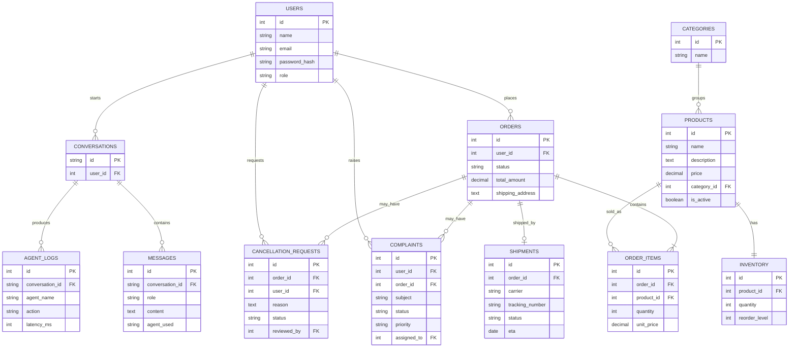
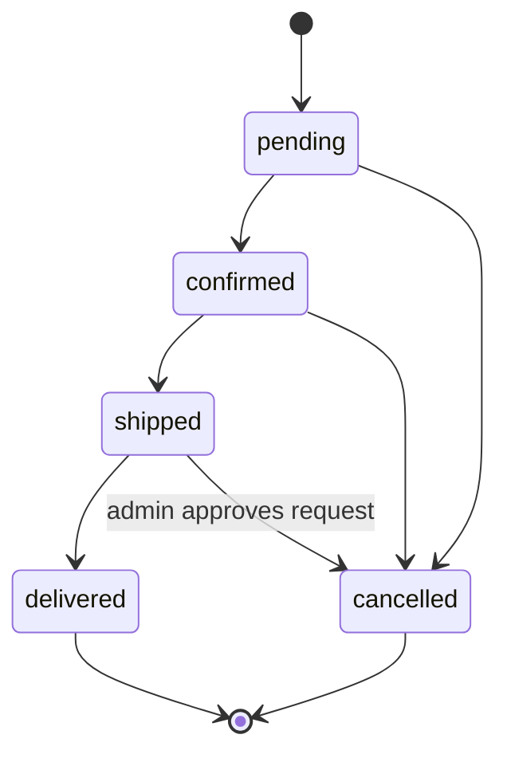

# Database Design

> Status: Draft v1
> Project: AI E-Commerce Operations Agent
> Database: PostgreSQL (permanent data), Redis (session and cache)

## 1. Overview

The database stores users, the product catalogue, stock, orders, shipments, cancellation requests, complaints, chat history and agent logs. All tables use an integer primary key `id` unless stated otherwise. Timestamps use `TIMESTAMPTZ`.

## 2. Entities and Columns

### 2.1 users

| Column | Type | Notes |
|--------|------|-------|
| id | SERIAL PK | |
| name | VARCHAR(100) | |
| email | VARCHAR(255) | Unique |
| password_hash | VARCHAR(255) | bcrypt hash |
| role | VARCHAR(20) | `customer` or `admin` |
| created_at | TIMESTAMPTZ | Default now |

### 2.2 categories

| Column | Type | Notes |
|--------|------|-------|
| id | SERIAL PK | |
| name | VARCHAR(100) | Unique |

### 2.3 products

| Column | Type | Notes |
|--------|------|-------|
| id | SERIAL PK | |
| name | VARCHAR(200) | |
| description | TEXT | Used for RAG |
| price | NUMERIC(10,2) | Must be >= 0 |
| category_id | INT FK | References categories(id) |
| image_url | TEXT | Optional |
| is_active | BOOLEAN | Default true (soft delete) |
| created_at | TIMESTAMPTZ | |
| updated_at | TIMESTAMPTZ | |

### 2.4 inventory

| Column | Type | Notes |
|--------|------|-------|
| id | SERIAL PK | |
| product_id | INT FK UNIQUE | One row per product |
| quantity | INT | Must be >= 0 |
| reorder_level | INT | Default 10; below this means low stock |
| updated_at | TIMESTAMPTZ | |

### 2.5 orders

| Column | Type | Notes |
|--------|------|-------|
| id | SERIAL PK | |
| user_id | INT FK | References users(id) |
| status | VARCHAR(20) | See status values |
| total_amount | NUMERIC(10,2) | |
| shipping_address | TEXT | |
| created_at | TIMESTAMPTZ | |
| updated_at | TIMESTAMPTZ | |

### 2.6 order_items

| Column | Type | Notes |
|--------|------|-------|
| id | SERIAL PK | |
| order_id | INT FK | References orders(id) |
| product_id | INT FK | References products(id) |
| quantity | INT | Must be > 0 |
| unit_price | NUMERIC(10,2) | Price at time of purchase |

### 2.7 shipments

| Column | Type | Notes |
|--------|------|-------|
| id | SERIAL PK | |
| order_id | INT FK UNIQUE | One shipment per order |
| carrier | VARCHAR(100) | Mock carrier name |
| tracking_number | VARCHAR(100) | |
| status | VARCHAR(30) | See status values |
| eta | DATE | Estimated delivery |
| updated_at | TIMESTAMPTZ | |

### 2.8 cancellation_requests

| Column | Type | Notes |
|--------|------|-------|
| id | SERIAL PK | |
| order_id | INT FK | References orders(id) |
| user_id | INT FK | Requesting customer |
| reason | TEXT | |
| status | VARCHAR(20) | See status values |
| admin_note | TEXT | Optional |
| reviewed_by | INT FK NULL | References users(id), admin |
| created_at | TIMESTAMPTZ | |
| reviewed_at | TIMESTAMPTZ NULL | |

### 2.9 complaints

| Column | Type | Notes |
|--------|------|-------|
| id | SERIAL PK | Also used as ticket id |
| user_id | INT FK | References users(id) |
| order_id | INT FK NULL | Optional link to an order |
| subject | VARCHAR(200) | |
| description | TEXT | |
| status | VARCHAR(20) | See status values |
| priority | VARCHAR(10) | `low`, `medium`, `high` |
| assigned_to | INT FK NULL | References users(id), admin |
| admin_reply | TEXT NULL | Latest admin reply |
| created_at | TIMESTAMPTZ | |
| updated_at | TIMESTAMPTZ | |

### 2.10 conversations

| Column | Type | Notes |
|--------|------|-------|
| id | VARCHAR(36) PK | Same as `session_id` |
| user_id | INT FK | References users(id) |
| created_at | TIMESTAMPTZ | |
| last_active_at | TIMESTAMPTZ | |

### 2.11 messages

| Column | Type | Notes |
|--------|------|-------|
| id | SERIAL PK | |
| conversation_id | VARCHAR(36) FK | References conversations(id) |
| role | VARCHAR(20) | `user`, `assistant` or `system` |
| content | TEXT | |
| agent_used | VARCHAR(30) NULL | For assistant messages |
| created_at | TIMESTAMPTZ | |

### 2.12 agent_logs

| Column | Type | Notes |
|--------|------|-------|
| id | SERIAL PK | |
| conversation_id | VARCHAR(36) FK NULL | |
| user_id | INT FK NULL | |
| agent_name | VARCHAR(30) | `supervisor`, `product`, `inventory`, `order_tracking`, `support` |
| action | VARCHAR(100) | Tool or step name |
| input | JSONB | Tool arguments |
| output | JSONB | Tool result (no secrets) |
| status | VARCHAR(20) | `success` or `error` |
| latency_ms | INT | |
| created_at | TIMESTAMPTZ | |

### 2.13 product_embeddings (only if pgvector is chosen)

| Column | Type | Notes |
|--------|------|-------|
| id | SERIAL PK | |
| product_id | INT FK NULL | Null for policy or FAQ chunks |
| source | VARCHAR(50) | `product`, `faq` or `policy` |
| chunk_text | TEXT | |
| embedding | VECTOR(n) | n depends on the embedding model |

## 3. Relationships

| Relationship | Type |
|--------------|------|
| users to orders | 1 : N |
| users to complaints | 1 : N |
| users to conversations | 1 : N |
| categories to products | 1 : N |
| products to inventory | 1 : 1 |
| orders to order_items | 1 : N |
| products to order_items | 1 : N |
| orders to shipments | 1 : 1 |
| orders to cancellation_requests | 1 : N |
| orders to complaints | 1 : N (optional) |
| conversations to messages | 1 : N |
| conversations to agent_logs | 1 : N |

## 4. ER Diagram

## 5. Status Values (Enums)

| Entity | Allowed values |
|--------|----------------|
| orders.status | `pending`, `confirmed`, `shipped`, `delivered`, `cancelled` |
| shipments.status | `label_created`, `in_transit`, `out_for_delivery`, `delivered` |
| cancellation_requests.status | `pending_approval`, `approved`, `rejected` |
| complaints.status | `open`, `in_progress`, `resolved` |
| complaints.priority | `low`, `medium`, `high` |
| users.role | `customer`, `admin` |
| messages.role | `user`, `assistant`, `system` |

Order status flow:

## 6. Business Rules Enforced in the Database

- `users.email` is unique.
- `inventory.product_id` is unique (one stock row per product).
- `shipments.order_id` is unique (one shipment per order).
- `inventory.quantity >= 0`, `products.price >= 0`, `order_items.quantity > 0` (CHECK constraints).
- `order_items.unit_price` stores the price at purchase time so later price changes do not alter old orders.
- Products are soft-deleted (`is_active = false`) so old orders keep their references.
- Deleting an order cascades to its `order_items`.

## 7. Indexes

| Table | Index | Purpose |
|-------|-------|---------|
| users | `email` (unique) | Login lookup |
| orders | `user_id` | My orders |
| orders | `status`, `created_at` | Admin filters |
| order_items | `order_id` | Load items of an order |
| products | `name`, `category_id` | Search and filtering |
| inventory | `product_id` (unique) | Stock check |
| complaints | `status`, `assigned_to` | Admin queue |
| cancellation_requests | `status`, `order_id` | Pending list |
| messages | `conversation_id`, `created_at` | Chat history |
| agent_logs | `agent_name`, `created_at` | Monitoring |

## 8. Redis vs PostgreSQL

| Store | Data |
|-------|------|
| Redis | Active session state (`session:{id}`, 30 min TTL), search cache, rate-limit counters |
| PostgreSQL | Everything in sections 2.1 to 2.13 |

## 9. Sample Data Plan

Seed data for development and demo:

- 2 admin users and 5 customer users
- 5 categories and 30 products with descriptions
- Inventory for every product, with a few low-stock items
- 20 orders in different statuses, each with items
- Mock shipments for shipped and delivered orders
- 3 pending cancellation requests and 5 complaints
- FAQ and policy documents for the RAG index

## 10. Data Flows per Feature

| Feature | Tables used |
|---------|-------------|
| Search products | products, categories, inventory |
| Check stock | inventory, products |
| Track order | orders, order_items, shipments |
| Request cancellation | orders, cancellation_requests |
| Admin approves cancellation | cancellation_requests, orders, inventory |
| Raise and handle complaint | complaints, orders |
| Chat | conversations, messages, agent_logs |
| Monitor operations | orders, complaints, inventory, agent_logs |