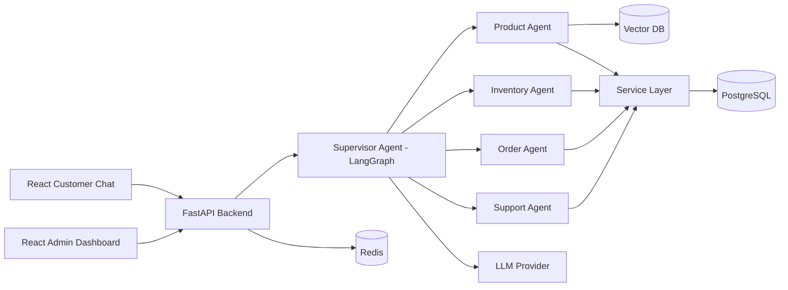

# System Architecture

ai-ecommerce-ops-agent/
├── backend/
│   └── app/
│       ├── api/        (routers)
│       ├── agents/     (LangGraph nodes, tools)
│       ├── services/   (business logic)
│       ├── models/     (SQLAlchemy)
│       ├── schemas/    (Pydantic)
│       └── core/       (config, security)
├── frontend/
│   └── src/
│       ├── pages/
│       ├── components/
│       └── api/
├── docs/
└── README.md
> Status: Draft