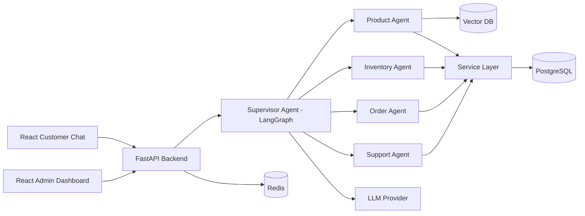
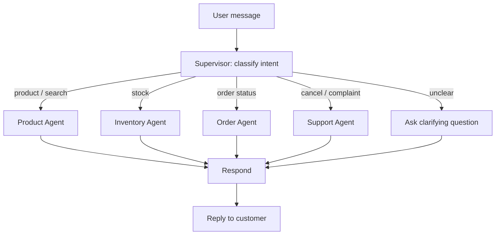
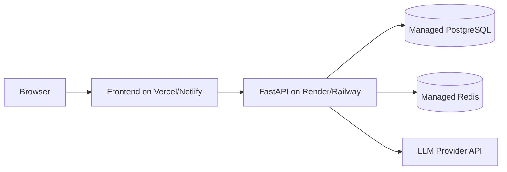

# System Architecture

> Status: Draft v1
> Project: AI E-Commerce Operations Agent

## 1. Overview

The system is a web platform where customers chat with a team of specialized AI agents, and admins manage operations from a dashboard. A React frontend talks to a FastAPI backend. The backend runs a LangGraph multi-agent workflow that uses tools (service layer, vector search) to read and write data in PostgreSQL. Redis keeps conversation state and cache. An LLM provider generates language; all facts come from tools or retrieved documents.

## 2. Architecture Diagram



| Component | Role |
|-----------|------|
| React Customer Chat | Chat window for customers |
| React Admin Dashboard | Products, inventory, orders, complaints, monitoring |
| FastAPI Backend | REST API, authentication, validation, routing |
| Supervisor Agent | Classifies intent, routes to agents, composes reply |
| Product / Inventory / Order / Support Agents | Specialized agents that call tools |
| Service Layer | Business rules and database access |
| PostgreSQL | Permanent data |
| Redis | Session state and cache |
| Vector DB | Embeddings for RAG |
| LLM Provider | Intent classification and reply generation |

## 3. Layers

| Layer | Responsibility | Technology |
|-------|----------------|------------|
| Presentation | Chat UI and admin dashboard | React |
| API | Receive requests, validate input, check auth and roles | FastAPI routers, Pydantic |
| Agent | Classify intent, choose agent, run tools | LangGraph, LangChain |
| Service | Business rules (for example, can this order be cancelled) | Python service modules |
| Data | Store data | PostgreSQL, Redis, Vector DB |

**Rule:** Agents never write raw SQL. They call service-layer functions exposed as tools. Business rules live in one place and permissions are enforced there.

## 4. Agent Workflow (LangGraph)

### 4.1 Message flow

1. React sends `POST /chat/message` with `session_id` and `message`.
2. FastAPI verifies the JWT and extracts `user_id` and `role`.
3. Session history is loaded from Redis.
4. The Supervisor classifies the intent (product, stock, order, support).
5. The matching agent is selected.
6. The agent calls a tool (service function, SQL through service, or vector search).
7. The tool result is passed to the LLM, which writes the reply.
8. The conversation is saved to Redis, the message and agent log to PostgreSQL.
9. React receives the JSON reply.

### 4.2 Graph definition

- **State:** `messages`, `user_id`, `role`, `session_id`, `intent`, `agent_used`, `tool_results`
- **Nodes:** `supervisor`, `product_agent`, `inventory_agent`, `order_agent`, `support_agent`, `respond`
- **Edges:** `supervisor` routes conditionally to an agent node; every agent node returns to `respond`.



### 4.3 Edge cases

| Case | Behaviour |
|------|-----------|
| Unclear message | Supervisor asks a clarifying question |
| Two intents in one message | Both agents run and the reply is combined |
| LLM fails or times out | Friendly error message, HTTP 503 `LLM_UNAVAILABLE` |
| Action needs admin approval | A request is created with status `pending_approval` |
| Tool returns nothing | Agent says it has no information; it never guesses |
| Another user's order requested | Treated as not found |

## 5. RAG Pipeline

**Indexing** (on setup and whenever an admin changes a product):

```
Product descriptions + FAQs + policies
  -> chunking (300-500 words)
  -> embeddings
  -> Vector DB
```

**Query** (each product question):

```
Question -> embedding -> top 3-5 similar chunks
  -> added to the LLM prompt -> grounded answer
```

| Decision | Choice | Note |
|----------|--------|------|
| Vector DB | pgvector (or Chroma for local dev) | pgvector avoids an extra service in deployment |
| Embeddings | Provider embedding model | Match the LLM provider |
| Chunk size | 300-500 words with small overlap | Tune after testing |
| Re-indexing | On product create, update or delete | Keeps answers current |

## 6. Redis vs PostgreSQL

| Store | Keeps | Why |
|-------|-------|-----|
| Redis | Active session state, recent messages, product search cache, rate-limit counters | Fast, temporary data |
| PostgreSQL | Users, products, inventory, orders, complaints, cancellations, chat history, agent logs | Permanent, relational data |

Redis key examples:

| Key | Value | TTL |
|-----|-------|-----|
| `session:{session_id}` | Recent messages and state | 30 minutes |
| `cache:search:{hash}` | Search results | 5 minutes |
| `ratelimit:{user_id}` | Request counter | 1 minute |

## 7. Tech Decisions

| Area | Choice | Reason |
|------|--------|--------|
| Frontend | React | Component based; suits chat and dashboard |
| Backend | FastAPI | Fast, async, Pydantic validation, automatic API docs |
| Database | PostgreSQL | Relational data such as users and orders |
| Cache / state | Redis | Fast session storage |
| Agent framework | LangGraph | Multi-agent flows with explicit state |
| Retrieval | RAG + vector DB | Reduces hallucination |
| API testing | Postman | Test endpoints and demo them |
| Version control | Git + GitHub | Commit history is part of evaluation |

## 8. Deployment

| Part | Platform (suggested) |
|------|----------------------|
| Backend (FastAPI) | Render or Railway |
| Frontend (React) | Vercel or Netlify |
| PostgreSQL | Managed Postgres (Render, Railway or Neon) |
| Redis | Upstash or Railway Redis |
| Secrets | Environment variables only |

- Frontend URL: _to be added_
- Backend URL: _to be added_
- Free-tier services may sleep when idle. Open them before any demo.



## 9. Security

- Passwords are hashed (bcrypt).
- JWT access tokens with expiry; role stored in the token.
- Role-based access: `/admin/*` is admin only.
- Every order, complaint and session query filters by `user_id`.
- Input validation with Pydantic.
- API keys live in `.env`; `.env` is listed in `.gitignore`.
- CORS allows only the deployed frontend origin.
- Prompt-injection defence: user text is treated as data, never as instructions; tools enforce permissions themselves, regardless of what the LLM asks.
- Rate limiting on the chat endpoint.

## 10. Planned Repository Structure

```
ai-ecommerce-ops-agent/
├── backend/
│   ├── app/
│   │   ├── api/         # FastAPI routers
│   │   ├── agents/      # LangGraph graph, agent nodes, tools
│   │   ├── services/    # business logic
│   │   ├── models/      # SQLAlchemy models
│   │   ├── schemas/     # Pydantic schemas
│   │   └── core/        # config, security, dependencies
│   ├── tests/
│   ├── requirements.txt
│   └── .env.example
├── frontend/
│   └── src/
│       ├── pages/
│       ├── components/
│       └── api/
├── docs/
└── README.md
```
### Redis keys (implemented)

| Key | Purpose | TTL |
|-----|---------|-----|
| `session:{id}` | Session owner and metadata | 30 min, extended on each message |
| `session:{id}:messages` | Last 20 messages | 30 min, extended on each message |
| `cache:product:{id}` | Cached product details | 60 s, deleted when product or stock changes |
| `ratelimit:{scope}:{id}` | Request counters | 60 s |

If Redis is down: cache and rate limiting are skipped, chat returns 503.